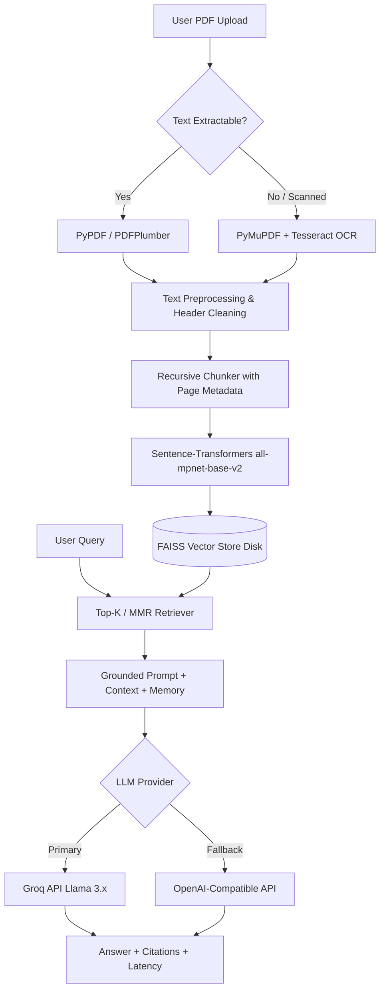

# AskMyDocs: LLM-Powered Document Summarization & Semantic Information Retrieval

[](https://www.python.org/downloads/)
[](https://streamlit.io/)
[](https://www.langchain.com/)
[](https://github.com/facebookresearch/faiss)
[](https://opensource.org/licenses/MIT)

**AskMyDocs** is a Retrieval-Augmented Generation (RAG) web application developed for B.Tech Computer Science & Engineering (Session 2026–27). It enables natural language chat with multiple uploaded PDF documents (both text-based and scanned images) with strict grounding, precise page/snippet citations, and hierarchical map-reduce summarization.

---

## 👥 Project Team

- **Authors:** Itisha Sharma & Kanishka Gupta
- **Project Guide:** Dr. Shanu Sharma
- **Department:** Department of Computer Science & Engineering
- **Institution:** ABESEC Ghaziabad (Session 2026–27)

---

## 🌟 Key Features

1. **Dual PDF Extraction Pipeline:**
   - **Text-based PDFs:** Fast text extraction via `PyPDF` with automatic fallback to `PDFPlumber` when character garbling is detected.
   - **Scanned / Image PDFs:** Optical Character Recognition (OCR) path rendering high-DPI pages via `PyMuPDF` (fitz) and extracting text via `pytesseract` (graceful fallback if Tesseract binary is absent).
2. **Context-Preserving Chunking & Deduplication:**
   - `RecursiveCharacterTextSplitter` with 800-character chunks and 150-character overlap.
   - Rich chunk metadata tracking `source`, `page`, `chunk_id`, and `is_ocr` flags.
   - SHA-256 document hashing avoids re-embedding unchanged documents.
3. **Local Vector Search:**
   - Embeddings generated locally via `sentence-transformers/all-mpnet-base-v2` (normalized for cosine distance; runs CPU-only without API keys).
   - `faiss-cpu` vector store persisted to disk with incremental merge and reset controls.
   - Retrieval with top-$k$ similarity and optional Maximal Marginal Relevance (MMR) for diversity.
4. **Multi-LLM Generation Layer with Grounding:**
   - **Groq API:** Ultra-fast Llama 3.x inference (`llama-3.3-70b-versatile`, `llama-3.1-8b-instant`). Fetches active models live from Groq API.
   - **OpenAI-Compatible API:** Configurable `OPENAI_BASE_URL` and `OPENAI_API_KEY` for flexible fallback.
   - **Automatic Fallback:** Retries and switches providers seamlessly on rate limits or API errors.
   - **Strict Grounding:** Strict system prompt prevents hallucinations; answers ONLY from retrieved context with page citations.
5. **Hierarchical Map-Reduce Summarization:**
   - Summarizes long documents across multiple chunks without context window truncation.
   - Supports 3 distinct styles: **Short** (executive summary), **Detailed** (structured technical sections), and **Bullets** (key takeaways).
6. **Streamlit UI:**
   - Tabs for Chat, Summarizer, Document Index inspection, and live System Logs.
   - Conversation export to `.txt` and `.md`.

---

## 🏗️ System Architecture



---

## 🚀 Quick Start

### 1. Prerequisites
- Python 3.10 or higher
- Git
- (Optional) [Tesseract OCR](https://github.com/UB-Mannheim/tesseract/wiki) for scanned PDFs

### 2. Clone the Repository
```bash
git clone https://github.com/itisha5906/Askmydocs.git
cd Askmydocs
```

### 3. Setup Virtual Environment & Install Dependencies
On Windows:
```bash
python -m venv venv
venv\Scripts\activate
pip install -r requirements.txt
```

On Linux/macOS:
```bash
python3 -m venv venv
source venv/bin/activate
pip install -r requirements.txt
```

### 4. Configure Environment
Copy `.env.example` to `.env` and fill in your API keys:
```bash
cp .env.example .env
```
Edit `.env`:
```env
GROQ_API_KEY=your_groq_api_key_here
OPENAI_API_KEY=your_openai_api_key_here
OPENAI_BASE_URL=https://api.openai.com/v1
OPENAI_MODEL=gpt-4o-mini
```

### 5. Run the Application
```bash
streamlit run app.py
```
Open **`http://localhost:8501`** in your browser.

---

## 🧪 Testing

Run all unit tests with pytest:
```bash
pytest tests/ -v
```
All **58 unit tests** run with mocks and do not require external API tokens.

---

## 📂 Project Structure

```
askmydocs/
├── app.py                  # Streamlit Presentation Layer
├── config.py               # Central configuration & secrets loader
├── requirements.txt        # Pinned dependencies
├── .env.example            # Environment variable template
├── .gitignore              # Secrets & FAISS index exclusion
├── README.md               # Project documentation
├── QUICKSTART.md           # Fast setup guide
├── Dockerfile              # Container deployment recipe
├── core/                   # Processing, Retrieval, and LLM services
│   ├── loader.py           # Dual PDF extraction (PyPDF / PDFPlumber)
│   ├── ocr.py              # OCR path for image pages (PyMuPDF + Tesseract)
│   ├── preprocess.py       # Text cleaning & header/footer removal
│   ├── chunker.py          # Recursive text splitter with metadata
│   ├── embeddings.py       # Local HuggingFace all-mpnet-base-v2
│   ├── vectorstore.py      # FAISS build, persistence, and merge
│   ├── retriever.py        # Top-K & MMR retriever with doc filtering
│   ├── llm_factory.py      # Groq & OpenAI provider with fallback
│   ├── rag_chain.py        # Grounded QA chain with source citations
│   ├── summarizer.py       # Map-reduce document summarizer
│   ├── services.py         # Unified facade consumed by UI
│   └── logger.py           # File + Streamlit log buffer
├── tests/                  # Pytest test suites (58 tests)
└── sample_docs/            # Sample documents for smoke tests
```

---

## 📜 License

This project is open-source and available under the [MIT License](LICENSE).
